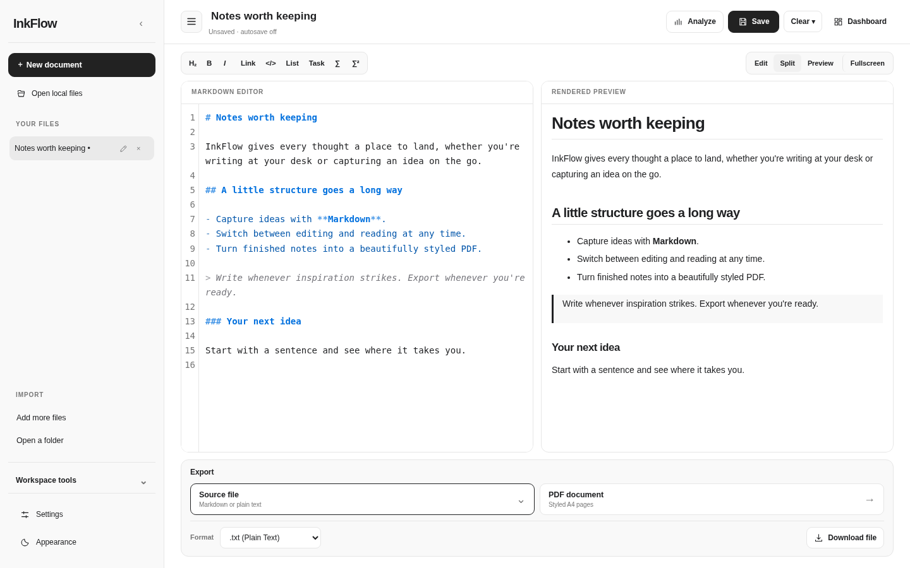

# InkFlow

**A local-first Markdown writing workspace with math, writing feedback and beautifully styled PDF exports.**

InkFlow runs entirely in your browser. Write and preview Markdown, work across multiple local documents, check writing quality, render LaTeX equations and export multi-page A4 PDFs with 12 stationery templates. Its interface adapts to desktop and mobile screens.

**Status:** v1.5.0 · client-side static web app · Node.js ≥18 for the included development server · no account or backend required.

## Interface preview

InkFlow keeps the focus on writing. The file sidebar is collapsible, the Dashboard opens only when needed, and the two export paths—source files or styled PDFs—are clearly separated. The editor works on desktop and on narrow mobile screens, with native text selection on mobile.



[Mobile writing interface](docs/images/inkflow-workspace-mobile.png) · [PDF style selection and page preview](docs/images/inkflow-export-preview.png)


## Features

- **Markdown editor:** syntax highlighting, completion, shortcuts, live rendered preview and split view.
- **Mathematics:** inline `$...$` and display `$$...$$` formulas rendered locally using MathJax, including in PDF.
- **Full-screen preview:** desktop and mobile, with Escape/Close to return.
- **Multi-document workspace:** import multiple `.md` or `.txt` files, switch tabs, and export/restore a workspace JSON backup.
- **Writing analysis:** local rule-based clarity, style and Markdown structure suggestions, with jump-to-text.
- **Optional grammar and spelling:** on-device English checking through Harper, with AU/UK/US/CA variants (one-time dependency installation required).
- **Styled PDFs:** 12 themes, thumbnail gallery, per-page A4 decorations, multi-page pagination and a phone-friendly direct PDF download.
- **Control over data:** auto-save is **off by default**; manually save or explicitly enable auto-save; separate Clear canvas and Clear storage actions, plus an optional line-number gutter in Settings.

## Quick start

**Prerequisite:** Node.js 18+.

```bash
# From the extracted InkFlow project directory
npm start
```

Open **http://localhost:4173**. Markdown, preview, math, workspace, writing analysis and PDF export are available without installing npm dependencies. The built-in server is a development convenience, not a backend.

To enable the optional Harper **Grammar Check** (requires internet once during installation):

```bash
npm install
npm start
```

`npm install` downloads the pinned `harper.js@2.4.0` package and copies the browser runtime to `vendor/harper/`. After this, grammar checks run **locally** in the browser, without submitting documents to an online grammar API. The packaged source distribution **does not include Harper binaries** until you install them.

> Do not double-click `index.html` using `file://`; ES modules, Web Workers and WASM need an HTTP origin. `npm start` provides a localhost-only static server.

## How to use

1. Write Markdown in the editor, or choose **Open local files**, **Add more files** or **Open a folder** in the sidebar (browser permissions apply).
2. Switch between **Edit**, **Split**, **Preview** and **Fullscreen**; use `$...$` and `$$...$$` for equations.
3. Choose **Analyze** for local writing advice. Click **Check grammar** to load optional Harper.
4. In **Export**, choose **Source file** for a `.md` / `.txt` download, or choose **PDF document** to browse 12 styles, inspect paginated A4 previews, and choose **Download A4 PDF**. Desktop also offers a **Print** option.
5. Use **Workspace tools** in the sidebar to back up or restore all open tabs. The **Clear** menu in the document toolbar has separate canvas and browser-storage actions.

**Saving:** the Save button stores the current workspace in that browser's LocalStorage. Auto-save can be enabled under Settings. Importing or editing does not write to the original disk files; download the updated file or a workspace backup. A browser refresh discards unsaved in-memory changes. Some UI preferences are stored locally even when auto-save is off.

## Development

```bash
npm test                 # local Node test suite
npm run build            # copies static deployable files into dist/
npm start                # starts the app on 127.0.0.1:4173
PORT=8080 npm start      # use another local port
npm run setup:harper     # repeat local Harper runtime copy after installation
npm run package:offline  # creates portable ZIP (only after Harper is installed)
```

No framework build system or backend is required. `npm run build` creates a static `dist/` directory, without contacting external services; it warns if optional Harper runtime is not yet present.

### Project layout

```text
inkflow/
├── index.html                 # interface
├── css/                       # original UI, editor, responsive and PDF styles
├── js/                        # app controller, math, workspace, grammar, analysis, PDF
├── assets/stationery/         # art and template previews
├── vendor/mathjax/            # bundled local MathJax distribution
├── vendor/harper/             # populated after npm install
├── scripts/                   # local server, static build, packaging
├── tests/                     # Node regression tests
├── docs/                      # deployment and preview images
├── .github/workflows/         # CI checks
└── package.json
```

## Deploy to GitHub Pages or another static host

```bash
npm install   # needed only if deployed Grammar Check should work
npm run build
```

Publish the **contents of `dist/`** on your static host (not `node_modules/`). For GitHub Pages, configure Pages to serve your static build through your preferred Pages workflow or branch; paths are relative and work under a repository subpath. See [Deployment guide](docs/DEPLOYMENT.md) for specifics.

All editing and analysis take place client-side. Hosting a static site is not a grammar checking backend.

## Privacy and limitations

- **No account / no document upload to a backend:** text stays in your browser for writing analysis and Harper checks. Loading npm dependencies is separate from document processing.
- **Auto-save is opt-in.** Manual Save writes browser LocalStorage; Workspace export downloads a JSON backup. Clear storage deletes saved InkFlow state in that browser origin. [Privacy details](PRIVACY.md).
- **Grammar:** Harper is English-focused and may produce incorrect suggestions. Real Harper checking requires its browser runtime files; those are not shipped in this source ZIP.
- **PDF:** **Download A4 PDF** generates real 210 × 297 mm PDF pages in the browser without relying on the mobile print dialog (rendered as images, so text is not selectable). Desktop **Print** retains browser-native output with selectable text; native iOS Safari has not been physically tested. Very large documents may require substantial device memory, and cross-origin images may not be embedded.
- **Local files:** file/folder import does not grant ongoing disk access or allow silent overwrites. Relative local image paths may need hosting alongside the page.

## Contributing, security and licensing

See [CONTRIBUTING.md](CONTRIBUTING.md), [SECURITY.md](SECURITY.md) and [CHANGELOG.md](CHANGELOG.md).

InkFlow's project-authored code and assets are provided under the [MIT License](LICENSE). Third-party components have their **own licenses** (CodeMirror, marked, MathJax and optional Harper); see [THIRD_PARTY.md](THIRD_PARTY.md). **Before publishing under your identity, confirm you have rights to license all original contributions and update the copyright holder as appropriate.**
